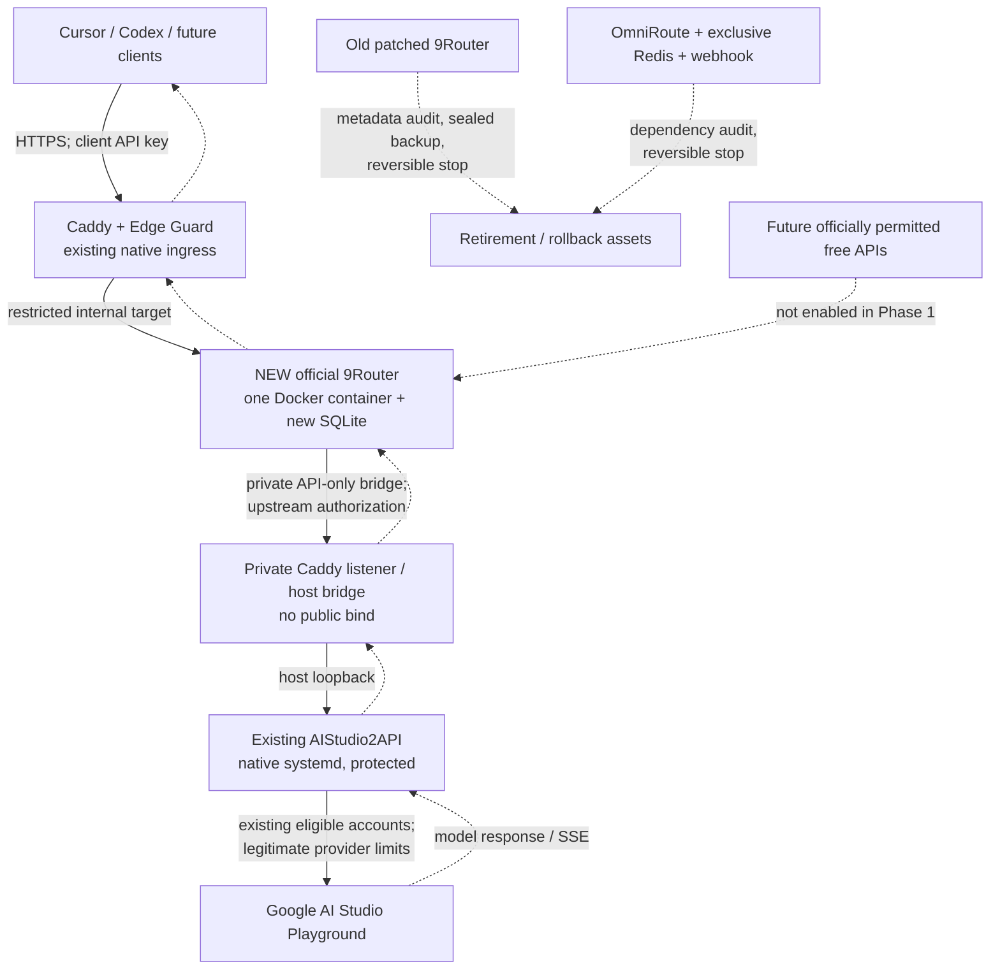

# MASTER PLAN V7 — CLEAN 9ROUTER, FREE-FIRST AI INFRASTRUCTURE

**Architecture Decision, Security Specification, Migration Plan, Acceptance Criteria & Execution Handoff**

| Field | Value |
|---|---|
| Date | 19 November 2026 |
| Language | English |
| Status | **APPROVED DESIGN DIRECTION — PLAN ONLY; NOT DEPLOYED** |
| Scope | Existing German AlmaLinux VPS; AI gateway and routing layer |
| Target | `srv4503740909` (`185.221.237.84`) |
| Supersedes | `FINAL_PLAN_V5.md`, earlier V5 workstream, and previous V6 clean-install proposals where explicitly amended here |
| Source of truth | This document for intended architecture; **live measurements and verified provider documentation** for execution facts |
| Implementation authority | **None granted by this document.** A separate, explicit execution instruction is required. |

> **Executive decision:** Keep the existing native AIStudio2API and existing Caddy + Edge Guard. Deploy **one new, unmodified, official 9Router Docker image**, pinned by immutable digest, with a **completely empty database**. Use it as the *only central AI API router*. Connect it to AIStudio2API through a private, authenticated, narrowly scoped host-to-container path. Once the replacement passes security, cost, tool-calling, operational, and client tests, migrate clients deliberately; then retire the old locally patched 9Router and OmniRoute/Redis via reversible stops followed by separately approved cleanup. Do not add LiteLLM, CLIProxyAPI, an external proxy/VPN, or a second production gateway.

---

## 0. Executive summary and hard decisions

1. **9Router is selected**; do not restart a general gateway competition. This choice is **conditional upon the stock build actually satisfying mandatory security and compatibility tests**. A failure triggers a documented design exception/ADR, not silent substitution or an unapproved patch.
2. **Install from zero.** The former `9router-candidate` image, database, APIs, keys, connections, pools, combinations, policies, and history are **not imported**. Legacy records may be inspected read-only as metadata to identify dependencies, never treated as approval to recreate a route.
3. **AIStudio2API stays native on AlmaLinux/systemd, protected and unchanged.** Its own official GUI is the only permitted settings interface, and any change through that UI requires specific owner approval; there is no such change in the baseline design.
4. **Caddy and Edge Guard remain the existing secure ingress.** Caddy may also provide one **private, dedicated, authenticated upstream bridge** to the loopback-only AIStudio2API; this is a narrowly scoped architectural mechanism, not an extra general-purpose API gateway.
5. **OmniRoute and its exclusive Redis leave the target AI architecture.** The old 9Router also leaves it. Stop only after dependency checks, canary success, verified backups and the relevant approvals. Remove only after a separate retention and deletion gate.
6. **Only explicit, authorized, non-billable route/model/capability combinations are enabled.** Every unknown or chargeable route fails closed. The existence of a `:free` model label or a dashboard cost estimate is not proof of structural no-billing.
7. **No proxy is added to the AI request path by default.** Independent VPN and network-monitoring infrastructure currently serving other purposes remains intact. Direct German VPS egress is not a guarantee of provider eligibility or authorization.
8. **Minimal deployment:** one new 9Router container + its persisted SQLite data. No Postgres, Redis, browser emulator, Headroom, auto-discovery/auto-warmup, account import, second router or unneeded background daemon.

### Final intended topology (logical; not yet implemented)

**Physical placement:** Caddy, Edge Guard and AIStudio2API stay on the host; **only the new 9Router is added as a Docker container**. Google runs the models remotely. Coding clients, not the server gateway, execute local files, terminal actions and other client tools.

### Role ownership — no duplicated responsibilities

| Component | Owns | Must not do |
|---|---|---|
| Clients (Cursor, Codex, apps) | User intent, model request, tool execution, agent continuation | Assume an API gateway runs local tools |
| Caddy + Edge Guard | TLS, edge access policy, public route, ingress controls | Select Google account or rewrite model behavior |
| Fresh 9Router | Client credentials, client-facing aliases, route/model allowlist, approved upstream selection, bounded route-level fallback, health and redacted telemetry | Recreate private AIStudio2API per-account quota management; silently select paid routes |
| Private API bridge | Strictly scoped internal network reachability and upstream access protection | Expose AIStudio2API admin/account endpoints or public listener |
| Protected AIStudio2API | Existing account eligibility, model access, account-level cooldown, Playground protocol and generation | Be modified merely to fit the router |
| Google AI Studio | Actual model inference and provider-level limits | Be represented as providing unlimited or guaranteed quota |
| CCBar (optional Windows) | Local coding-tool session and quota monitoring | Run as a VPS daemon or replace provider account measurements |

---

## 1. Verified historical baseline versus execution-day facts

**Evidence category:** the following data was observed by authorized *read-only* SSH/Docker inspection on 19 November 2026; it is historical, must be remeasured at implementation, and does **not** prove an integrated live route.

| Item | Observed, not a performance guarantee |
|---|---|
| OS / host | AlmaLinux 9.8; approximately 2 vCPU |
| Memory | 3,655 MiB total; approximately 1,777–1,796 MiB available |
| Swap | 4,095 MiB total; approximately 1,586–1,588 MiB in use |
| Root volume | 58 GB total; 36 GB used; ~20 GB free; 65% utilized |
| Old 9Router | Container `9router-candidate`, locally modified `local/9router:quota-thinking-repair-v2-20261108`; ~44 MiB idle RAM |
| Old 9Router state | `/opt/9router-migration/candidate-data`; ~2 API-key records, 10 provider connections (6 Gemini, 4 custom OpenAI-compatible), multiple combos, ~6,907 usage rows; no state to import |
| Old 9Router isolation | Docker network `9router-stage-internal`, `internal=true`; no host port published; restart policy `no` |
| OmniRoute + Redis | Containers `omniroute` (~489 MiB) and `omniroute-redis` (~11 MiB) at observation; host `127.0.0.1:20128` belongs to OmniRoute |
| Edge | `caddy.service` active; config `/opt/edge/caddy/Caddyfile.public`; Edge Guard listener on host `127.0.0.1:9081` |
| Old R9 ingress | `r9.185-221-237-84.sslip.io:41873` returned HTTP 401 without credentials; this does **not** prove 9Router's own key enforcement |
| AIStudio2API | Native `aistudio2api.service` active; `127.0.0.1:2048/health` returned HTTP 200 |
| Other AIStudio2API endpoints | Host listeners `2050`, `2148`, `2150` observed; exact ownership and roles must be verified |
| Container-to-upstream | `172.19.0.1:2048/health` from old container: connection refused, consistent with upstream loopback bind; `172.19.0.1:20139` gave HTTP 403 |
| Additional services | `9router-gemini-egress.service`, `omni-ops-webhook.service`, unrelated VPN and monitoring services, including `steve-amnezia-awg` and `germany-vpn-monitor` |

**Important risk discovered:** the host's `127.0.0.1:20128` is **not** old 9Router; it is OmniRoute. Also, `localhost` inside a Docker container does **not** refer to the AlmaLinux host. Neither a guessed base URL nor a generic 401/200 status is sufficient integration evidence.

**Unknowns to close first:** precise roles of 2048/2050/2148/2150; old routing consumers; dependency of the `20139` egress bridge; Edge Guard behavior for new routes; stock 9Router custom-upstream capabilities; real allowlist enforcement; and exact release-specific auth behavior.

---

## 2. Official upstream, image integrity and selection

**Official sources:**
- Repository: https://github.com/decolua/9router
- Official Docker guide: https://github.com/decolua/9router/blob/master/DOCKER.md
- Current documented runtime settings: https://github.com/decolua/9router/blob/master/README.md
- Docker Hub image tags: https://hub.docker.com/r/decolua/9router/tags
- Important reported auth defect: https://github.com/decolua/9router/issues/2834
- Important reported custom-provider/model visibility defects: https://github.com/decolua/9router/issues/3115 and https://github.com/decolua/9router/issues/3135

**As of 19 November 2026:** Docker Hub lists the official `0.5.119` image for `linux/amd64` and `linux/arm64`. A past publishing failure for this version was reported and must be reconciled against the *actual present image manifest*; the GitHub Releases page may lag tagged sources and Docker/npm packages. Do not confuse image publication with security certification. See also https://github.com/decolua/9router/issues/5641.

**Artifact selection protocol:**
1. Retrieve the official image manifest and package/version metadata at execution time; match the intended Git source/tag/commit where feasible.
2. Select a **specific upstream-published version** proven to start and pass the mandatory tests. The current 0.5.119 build is a candidate, **not a mandatory forever-version**.
3. Record `linux/amd64` manifest digest, multi-arch index digest if used, registry, publication time and deployment-time verification. Pin **by digest**. Do not use a floating `latest` tag in the final deployment.
4. Record whether signing, attestations, SBOM or an independently verifiable source/build mapping actually exist. Do not invent assurances not supplied upstream.
5. No local fork, patched JS bundle, imported old image, ad-hoc modified Dockerfile or invisible source transformation.
6. If the official build cannot meet the cost/auth/custom-provider gates: **BLOCKED**. Document the failure and escalate an ADR exception; do not silently weaken policies, bring back OmniRoute or add LiteLLM.

### Intended fresh container

| Setting | Target plan |
|---|---|
| Container | `9router-clean` (proposed name) |
| Image | Official `decolua/9router@sha256:<verified-digest>` |
| Runtime | Docker / root-managed deployment, restart policy enabled only after staging and persistence tests |
| Data | New private directory (proposed `/opt/9router-clean/data`), persistent `/app/data`, `DATA_DIR=/app/data` |
| Database | Brand-new SQLite `/app/data/db/data.sqlite`; never import historical DB/WAL/backups |
| Network | Dedicated user-defined bridge; no public host publication; edge reaches private endpoint through controlled loopback/container path |
| Staging port | Propose host loopback `127.0.0.1:20228` only if free and verified; container service keeps supported internal port |
| Dashboard | Local admin only via SSH tunnel or specifically authorized edge-protected route; not exposed on public API endpoint |
| Secrets | Generated high-entropy values protected from command line, shell history, public environment dumps and logs |
| Optional services | No Headroom, Redis, Postgres, OAuth helper, proxy pool, warmup or unnecessary background service |
| Docker hardening | Evaluate non-root user, capabilities dropped, `no-new-privileges`, writable mount boundaries, `pids-limit`, health check and tested memory ceiling; relax only when documented |

**First-boot safeguards:** Set a unique high-entropy initial password **before first start**; never allow the documented default `123456` to become operational. Set explicit random `JWT_SECRET`, `API_KEY_SECRET` and `MACHINE_ID_SALT` (check actual version's recognized variables). Favor a root-owned 0600 secret file or supported Docker secret mechanism. Environment variables can still be read by a privileged Docker administrator; **never claim an env file is encryption**. Do not put secrets in a repo or diagnostic artifacts. Set `AUTH_COOKIE_SECURE=true` if appropriate for HTTPS access, and verify real cookie behavior.

**Persistent data security:** It is unrealistic to demand that no credentials exist in the 9Router SQLite database/volume; provider credentials may be intentionally stored there. Instead require limited filesystem access, an account-secret inventory **without values**, encrypted restricted backups, log redaction, credential rotation procedure, and no exported tokens in reports.

---

## 3. Threat model and non-negotiable safety policy

### 3.1 Threats and mitigations

| Threat | Required defense and proof |
|---|---|
| Unknown/paying model unexpectedly routable | Server-side allowlist and a **real negative request** to a safe stub upstream proves refusal **before forwarding** |
| Unauthenticated API usage | Independent 9Router application-level auth + Caddy/Edge Guard edge checks; no-key/bad-key denied without hitting upstream |
| Public admin exposure | Only API paths on public host, dashboard via loopback/SSH tunnel or explicitly approved protected channel; scan public routes |
| Leaked Google/API credentials | No secret logging; restrict environment/volumes, backup encryption, sensitive-data scans and correct file permissions |
| Reusing unsafe prior configuration | New empty data store; no import from old API keys, provider records, OAuth sessions, combos or aliases |
| Paid failover or default combo | Single approved upstream at first; no combos; no paid OAuth/Developer API/Vertex routes; provider-level cost evidence |
| Network isolation accidentally lost | Docker bridge/private host bind, host firewall/Caddy source ACL, external negative reachability test |
| Excessive retry or account restriction | Bounded retry, no replay of side effects, observe upstream 429/403 and genuine cooldown; do not bypass provider limits |
| Side-effecting tool action executed twice | Agent/tool lifecycle tests; no retry after streamed partial tool call or completed tool execution |
| Live upstream changed or damaged | No AIStudio2API source/config/session/deployment edits; before/after health and immutable-artifact verification |
| Invisible old-client dependency | Dependency graph, Caddy log metadata, cutover canary, rollback assets, observation window |

### 3.2 Default-deny route policy

The first operational routing set is **one provider, one proven model, one scoped test client key, and no fallback**. Expand only after individually passing acceptance tests.

Each allowed route must carry: **upstream provider identity, exact model/alias, accepted request capability class, protocol and parameters, authorization evidence, provider-level billing guarantee, fallback class, current status, date checked, and test evidence**.

**Only these states are allowed:**
- `ENABLED`: evidence for authentication, authorization, cost, and capability is complete and tests passed.
- `BLOCKED`: missing proof, incompatible behavior, a provider restriction, or failed mandatory test.
- `DISABLED`: intentionally not in service, regardless of potential eligibility.

**Crucial enforcement detail:** A model disappearing from `/v1/models`, the UI or an `enabledModels` toggle is **not** proof that it cannot be requested. Reported issues #3115 and #3135 describe visibility/persistence inconsistencies for Custom Providers. Execute direct requests for (a) a known blocked model ID, (b) an unknown alias, (c) an unauthorized request to a known model, and (d) an unapproved fallback; all must be rejected without a call reaching a stub upstream. Recheck the behavior **after restart**. If stock 9Router does not enforce this fail closed, do not expose it to clients or declare success; an independently enforceable approved edge policy may be evaluated through a separate architectural review, never assumed sufficient without direct testing.

**Provider/source policy:**
- AIStudio2API remains on its existing Playground-only access path and its legitimate provider limits; do not enable billable Google Developer API or Vertex AI behind it.
- No provider bypass of verification states, region restrictions or explicit per-person quota limits. Do not use automatic account rotation to evade provider rules.
- Consumer subscription OAuth reused in third-party routers and documented-prohibited Antigravity access remain off; owner consent does not override a provider prohibition.
- New officially free API integrations are **future research only**, and require separate proof of billing-free status and eligibility before adding them.
- Model names in a public catalog are **not** proof of account eligibility; a single successful request is **not** proof of sustainable daily allowance.

### 3.3 Behavior under upstream errors

- **401/403**: classify as credentials/authorization/eligibility issue; do not automatically try another account to work around restrictions.
- **429**: preserve upstream cooldown semantics; no quota-burning retries or account fan-out.
- **503/connectivity timeout**: no automatic billable fallback; bounded retry **only before first token** if the request is safely retryable and tested.
- **After first stream output or any tool execution:** no automatic gateway replay.
- **When no eligible authorized capacity remains:** transparent error. Prefer refusal over silent downgrade or paid path.

---

## 4. Private networking design — container ↔ native service

### 4.1 Northbound (client → Caddy → 9Router)

- Keep the public 9Router HTTPS hostname behind existing Caddy + Edge Guard, but **do not repoint it during staging**.
- Stage with a non-public Docker endpoint, e.g. Docker port published only on host `127.0.0.1` with a verified free high port; use SSH forwarding for dashboard access. Firewall and Docker publishing rules must be inspected on the actual AlmaLinux/Docker version.
- Production Caddy should forward **only enumerated API routes** to the new 9Router, not the full dashboard/admin surface. Preserve SSE streaming, deadlines and authorization headers. Restrict any administrative surface through a different, approved access mechanism.
- Caddy is an existing component, not a new general proxy. Avoid a production chain through old OmniRoute or old 9Router.

### 4.2 Southbound (9Router → private host API bridge → AIStudio2API)

**Preferred design:** Keep AIStudio2API bound to `127.0.0.1:2048` on the host. Add a narrowly scoped **private Caddy listener** on a verified Docker-host bridge address, allowing only the new 9Router container network to reach required model API routes. Caddy then proxies to `127.0.0.1:2048` with normal AIStudio2API authentication. This listener must **not** bind a public interface or expose admin/account routes.

**Required staged investigation:**
1. Identify the correct AIStudio2API instance and API endpoints; do not assume 2048 is the only active legitimate instance.
2. Confirm actual 9Router container-to-host network connectivity and what Docker's `internal=true` bridge semantics imply on this host; design the new network independently rather than inheriting the old one.
3. Record the Caddy listener's destination IP/interface and exact source subnet/container policy. Include AlmaLinux SELinux, firewalld, Docker NAT/forwarding and bridge recreation/boot-order behavior.
4. Define allowlisted API paths and methods using the actual API contracts; reject admin endpoints; preserve `Authorization` forwarding and SSE. Avoid recording auth headers in access logs.
5. Apply appropriate listener-level source restrictions or firewall policy and test from (a) new 9Router container, (b) an unrelated container, (c) host, and (d) outside the VPS.
6. Preserve Caddy's existing public configuration and TLS services: validate proposed config separately, back it up, use a graceful reload only under the owner-approved change gate, and verify rollback without downtime.
7. Prove no route loops and no accidental double authentication failure. An authenticated AIStudio2API `/v1/models` lookup and a single minimal safe generation must work from the new container through this path.

**Fallback networking options, not automatic:** A carefully evaluated small independent Caddy listener/network arrangement if production Caddy cannot bind the private bridge safely; host networking is a last-resort exceptional design requiring a new owner-approved ADR due to lost isolation, loopback reachability and potential port conflicts. **Do not use `--network host` merely to save configuration work.**

**Important:** A private Caddy API listener is an **internal transport bridge**. It does not authorize publishing the whole AIStudio2API management interface or adding a second public routing gateway.

---

## 5. Runtime configuration, account separation and operational controls

### 5.1 Exactly one initial provider

- Create a stock 9Router Custom OpenAI-compatible provider pointing to the **private bridge** and carrying a dedicated upstream bearer credential stored securely.
- Verify the installed stock version truly supports the Custom Provider setup and model selection **through its supported UI or documented mechanism**; fail if not.
- Obtain model availability from authenticated AIStudio2API discovery and select **one real, account-eligible, permitted model** for the first canary. Do not assume a visible catalog entry works for all accounts.
- Give this route one explicit alias such as `ai-free-canary` (illustrative only); do **not** introduce broad `auto` aliases, model-name catch-alls or imported legacy combos.
- Generate a new uniquely scoped key for one canary client. Old client keys are not imported; rotate clients deliberately at cutover.
- After tests, expand aliases by verified capability (`coding-tools`, `fast-text`, `vision` only where each is proven), never by a purported universal free fallback.

### 5.2 Two levels of routing are intentionally different

**9Router:** chooses a permitted *upstream route* and enforces client-facing model policy. It sees upstream health/errors and tracks its own gateway-level usage.

**AIStudio2API:** chooses an eligible *Google account/model access* according to its existing implementation, quota windows and cooldowns. 9Router does not second-guess its internal account scheduler, pool Google credentials, or claim knowledge of private quotas.

**Optional future providers:** not part of the initial deployment. If later enabled, they must be officially authorized, structurally zero-overage, workload-compatible and approved; their addition is a separate change.

### 5.3 Model capability and agent correctness

A generic OpenAI-compatible `/v1/chat/completions` success does **not** establish compatibility with all clients. Record, per exact model+route+client:
- Plain chat and SSE streaming; correct `[DONE]`/termination behavior.
- **Genuine structured tool calls** (including call IDs, names, JSON args, streaming deltas, tool-result continuation), versus prompt-simulated text.
- Reasoning/thinking parameters and whether the router preserves or silently drops them.
- JSON schema/structured outputs if required.
- Vision/multimodal inputs if required and account eligible.
- Context window claims based on actual bounded tests/documentation; do not use large quota-burning limit probes.
- Failure semantics before first token, mid-stream, after tool execution and under timeouts.

**Tool execution locality:** Cursor/Codex executes the filesystem, terminal or other client tool. Neither Caddy nor 9Router should execute or replay client tool side effects. This must be shown in the acceptance test trace.

### 5.4 Cost and quota observations

Create separate views for:
1. **Advertised models**.
2. **Account eligible models**.
3. **One successful real request**.
4. **Provider-published quota**.
5. **Inferred allowance** (explicitly uncertain).
6. **Observed sustainable capacity over time** (historical logs; never inferred from a single canary).

Zero-billing assurance comes from actual provider plan and billing conditions **plus** router-level default-deny—not merely from a frontend price estimate. Token and request accounting must not require storing prompt bodies by default.

---

## 6. Acceptance test program — specification, not claimed results

**Every row begins `NOT_RUN`.** A test is `PASS` only with timestamp, command or request, expected output, actual redacted output, source path and environment/version. Do not run destructive or quota-exhaustion tests against production; use a synthetic upstream for negative/failure cases.

| Test | Requirement / mandatory pass criterion | Safe test approach |
|---|---|---|
| T01 | Verified official immutable image, correct platform and version | Manifest/digest/version review; running image compare |
| T02 | Entirely empty new DB before setup | Schema/table and provider/key/combo counters; no import |
| T03 | First boot safe | Unique password; default `123456` rejected; dashboard not public |
| T04 | Real 9Router app-key enforcement independent of Caddy | No/invalid/valid keys from inside network against stub; no forwarding of rejected requests |
| T05 | Server-side allowlist enforced, not UI-only | Direct known-disabled/unknown model requests + stub call counter = 0; persists across restart |
| T06 | Verified private upstream bridge | Correct endpoint and API authorization; unrelated networks and external sources denied |
| T07 | Stock Custom Provider works | Provider created via supported UI; no local patch; correct model route |
| T08 | Minimal real chat | One bounded authorized text response via full chain and direct control |
| T09 | Streaming/SSE semantics | No broken framing, double end markers or duplicate requests; final event preserved |
| T10 | Structured tool round trip | Real tool call and client tool result continuation, no gateway-side execution |
| T11 | Capability fidelity | Required reasoning/JSON/vision preserved or route disabled; no false capability claim |
| T12 | Failure safety | Synthetic 401, 403, 429, 503, timeout, pre-first-token/mid-stream failures; no retry loop or unapproved fallback |
| T13 | Side-effect safety | No automatic replay after tool execution or partial streamed tool call |
| T14 | Structural zero-cost | Provider billing status and allowlisted paths proven; unknown/paying models rejected before upstream |
| T15 | AIStudio2API non-regression | Health/auth/direct control, immutable file hashes; no operator-induced DB/session writes |
| T16 | Recovery durability | Container restart, persistence, host boot sequence, restored route, measured rollback |
| T17 | Resource/performance | Host memory/swap/CPU/disk; direct vs routed errors/latency/TTFT under small matched load |
| T18 | Public exposure audit | Public scans of owned endpoints; no unintended admin/private 9Router/AIStudio2API listener |
| T19 | Legacy dependency inventory | Actual client/API/Caddy/webhook/Redis/egress consumers identified and recorded |
| T20 | Secrets and backup security | No secrets in log/report/git; appropriate owner/mode, encrypted backup + isolated restore |
| T21 | Client canary and cutover | One test client then staged migration; deliberate key replacement; rollback demonstrated |
| T22 | Retirement without regressions | Stop old services only after dependency proof; other AI and VPN services healthy |

**Suggested initial performance targets (hypotheses, not promises):**
- At minimum retain ~800 MiB host `MemAvailable` during bounded staging; adjust only after measured justification.
- New 9Router under light representative load: investigate if RSS exceeds ~300 MiB; a hard Docker limit should be set above measured peak with headroom.
- Added gateway latency target around p50 ≤150 ms after separating upstream time; use repeatable, minimal, matched samples with confidence/limitations reported.
- No new OOM kills, unbounded swap growth, repeated 5xx, authentication regressions, unsafe retries or active paid routes.

**Mandatory for first client canary:** `T01–T10`, `T12–T15`, `T17–T20` pass as relevant. If genuine structured tool calling (`T10`) cannot be preserved, do not use the route for coding agents. Tests for features not offered by the chosen eligible model are marked `NOT_APPLICABLE` only with explicit justification; the master status vocabulary remains PASS / FAIL / PARTIAL / BLOCKED / NOT_RUN for actual executable tests.

---

## 7. Execution sequence and hold points (future mission only)

| Phase | Planned work | Exit evidence | Approval boundary |
|---|---|---|---|
| P0 — Baseline | Live read-only inventory; exact services, listeners, keys by ID only, consumer paths, current Caddy routes, old DB metadata | Dependency map, current status, baseline and unknowns | Read-only only |
| P1 — Recovery prep | Consistent DB backups, sealed archive, checksum, isolated restore rehearsal; no import of old state | Verified recovery package + rollback procedures | Backup sensitivity and access controlled |
| P2 — Artifact gate | Verify source/image release, digest, runtime support, chosen version, memory/disk, build provenance | Image decision record; deployment specification | If upstream fails hard requirement: STOP |
| P3 — Sealed clean install | Start stock 9Router with new DB, strong secrets, only private access, no provider, no combos | Empty-state proof, local auth and default password tests | Separate execution authorization required |
| P4 — Private integration | Owner-approved, narrowly scoped bridge, 1 provider, 1 allowlisted model, 1 test key | Validated Caddy configuration, private reachability and safe rollback | **Approval before modifying production Caddy** |
| P5 — Hard gates | Auth, allowlist, no-paid-path, streaming, tools, errors, exposure, backup, recovery and resource tests | T01–T20 evidence matrix; no critical FAIL or UNKNOWN | BLOCK any failed mandatory gate |
| P6 — One-client cutover | Approved endpoint swap, create/replace new client key, compare direct/routed results | Canary trace, owner gate, validated direct recovery | **Owner approval** |
| P7 — Legacy 9Router reversible stop | Confirm no consumers and no egress dependency; stop candidate only; preserve state | Reversible stop+restore, regression evidence | **Owner approval** |
| P8 — OmniRoute/Redis reversible stop | Confirm consumer-free including webhook and Caddy `omni.*`; stop containers exclusively, keep data | Reversible stop+restore, regression evidence | **Owner approval** |
| P9 — Observation | Suggested minimum 48 h inactive-use confirmation before stop and 14-day retention/rollback window after stop (negotiable) | Health/error and consumer-check history | No destructive cleanup automatically |
| P10 — Permanent cleanup and SOP | Delete only verified exclusive obsolete objects; measure actual reclaimed resources; final docs | As-built map, runbooks, audit/status | **Separate explicit destructive approval** |

### Stop conditions requiring an architecture exception

- Official stock 9Router fails actual app-level auth or fail-closed model denial.
- Custom OpenAI-compatible provider cannot faithfully proxy the selected AIStudio2API route.
- Caddy cannot safely provide the required private bridge without exposing administrative paths.
- Safe provider-level zero-billing cannot be established for any proposed additional source.
- Required structured tool calls fail, are turned into plain text, or are replayed unsafely.
- Cutover would harm protected AIStudio2API or unrelated services.
- Version-accurate fixes require maintaining a locally patched 9Router fork.

For any such condition: **mark BLOCKED, keep production unchanged, attach evidence, propose a narrowly scoped ADR revision for the owner.** Do not automatically return to OmniRoute or chain a second router.

---

## 8. Legacy retirement, backups and rollback

### 8.1 Audit targets and dependencies

- `9router-candidate`: historical database and possible clients, its Caddy `r9.*` routes, `9router-gemini-egress.service` (`172.19.0.1:20139`), staging Docker bridge, backup scripts and local build artifacts.
- `omniroute`: existing host loopback 20128/20129/20132, Caddy `omni.*` ingress routes, local patch mount points, `/opt/omniroute/data`, startup/restart policy.
- `omniroute-redis`: dedicated volume (`omniroute_redis-data`) and proof of exclusive use before removal.
- `omni-ops-webhook.service`: identify external callers, callbacks, Caddy route and dependencies; never stop solely because its name contains `omni`.
- Protected unrelated: AIStudio2API native services, safety monitors, any required warmup scheduler, Caddy/Edge Guard, VPN and network monitoring, SSH/Cockpit and existing independent applications.

### 8.2 Backups

- For each live SQLite database use an **online-consistent backup** or supported app snapshot—not a raw hot copy that misses WAL changes.
- Record path, size, checksum, date, app version and restore instructions **without exporting credentials into the report**.
- Treat database backups, Docker env files, OAuth tokens and secret configs as sensitive; encrypt and restrict access. Restore rehearsal occurs only in a scratch environment and may **not** start a network-accessible legacy service.
- Protect remaining free disk and memory; do not assume image size equals reclaimable bytes.

### 8.3 Rollback stages

| Time | What rolls back | Safety conditions |
|---|---|---|
| Before client cutover | Stop/remove only new staging resources and restore any changed private Caddy config | No legacy state touched; no production cutover |
| During one-client canary | Switch the canary client to the verified former direct AIStudio2API path and restore ingress if needed | Do not silently reactivate unsafe old OAuth or paid-provider routing |
| After legacy reversible stop | Restart only the actually required old service if verified safe; restore backed-up Caddy routes and check authentication | Legacy use is a temporary recovery, not approval of its prior settings |
| After final cleanup | Restore only from the verified archival package under explicit recovery authorization | Data destruction is irreversible without backup; retention gate matters |

### 8.4 Retirement schedule

1. Establish zero active consumers with a documented observation window (proposal: 48 hours); distinguish API traffic, dashboard hits, health probes, and unrelated clients.
2. Keep the old components available but **not in the new production request chain** while the new system runs a canary.
3. After owner approval, stop legacy containers/services **reversibly**, validate adjacent systems and record exact restart behavior (especially `unless-stopped`).
4. Suggested rollback retention: 14 days, adaptable to observed use and operational risk.
5. Only then request separate approval for deletion of legacy containers, images, exclusively used volumes, old patch files and related Caddy hooks; do not delete shared Docker layers or other services by broad pruning commands.
6. Measure actual freed RAM/disk in the post-cleanup report.

---

## 9. Explicit approval gates and execution boundaries

**This is a master plan, not permission to run deployment commands.** The owner explicitly requested planning only.

During a future implementation mission, the executing agent may independently research, measure and perform specifically authorized isolated staging, but **must pause for approval before**:
- Production Caddy/Edge Guard/firewalld changes or new public exposure.
- Any AIStudio2API GUI setting change, and absolutely no source/config/session/deployment edits.
- Moving any production client to the new endpoint, changing the client's actual keys, or revoking an old key.
- Stopping, removing or changing restart behavior of legacy 9Router/OmniRoute/Redis/webhook/egress processes.
- Deleting or overwriting existing files, images, volumes, credentials or backups; changing independent VPN/network services.
- Enabling any billable or unknown-cost provider or provider-disallowed route. **Owner approval alone does not make a provider-prohibited route permissible.**

**Planning-time environment policy:** never modify VPS, Docker, Caddy, AIStudio2API, client settings or credentials on the basis of this document. All tests in this document remain `NOT_RUN` until future execution generates real evidence.

---

## 10. Deliverables expected from the future executor

| File | Required content |
|---|---|
| `00_LIVE_BASELINE_AND_DEPENDENCIES.md` | Actual topology, services, listeners, sources, consumers and timestamped measurements |
| `01_9ROUTER_UPSTREAM_ARTIFACT_AND_SECURITY.md` | Image digest, version, provenance, release defects, security assumptions |
| `02_CLEAN_BOOTSTRAP_AND_DATA_INVENTORY.md` | Container spec, network, data permissions, new DB, zero-state evidence |
| `03_PRIVATE_BRIDGE_DESIGN_AND_TESTS.md` | Caddy/host bridge configuration, private ACL tests, owner gate and rollback |
| `04_FREE_ROUTE_AND_CAPABILITY_MATRIX.csv` | Exact enabled aliases/models, verified capability and cost/authorization evidence |
| `05_AUTH_ALLOWLIST_NEGATIVE_TESTS.md` | Real no-key/bad-key/unknown-model results proving no upstream forwarding |
| `06_END_TO_END_AGENT_TESTS.md` | Chat, SSE, structured tools and safe failures; client and model identity |
| `07_RESOURCE_COST_AND_RELIABILITY.md` | Before/after RAM, CPU, swap, disk, latency, genuine account and quota observations |
| `08_CLIENT_CANARY_AND_CUTOVER.md` | Owner approval, selected client change, success/failure, return path |
| `09_LEGACY_RETIREMENT_AND_ROLLBACK.md` | Old 9Router, OmniRoute, Redis, webhook, egress dependencies; verified restore |
| `10_AS_BUILT_AND_OPERATIONAL_RUNBOOK.md` | Final proven topology, start/stop/restart, secrets rotation, incident response |
| `11_OPEN_RISKS_AND_NOT_RUN.md` | Every incomplete or blocked item, no invented PASS |

All execution reports and owner-facing artifacts must be **in English** unless the owner explicitly requests otherwise. No passwords, tokens, cookies, API keys or personal account identifiers may appear in reports.

---

## 11. Definition of done — what qualifies as a working system

**Go-live requires all of the following:**

- New stock 9Router image/digest verified and immutable; fresh empty DB at first start; default credential rejected.
- Independent, enforced API authentication and protected dashboard; no unauthorized paths reach an upstream request.
- Proven server-side allowlist: unknown, disabled and paid model requests cause **zero upstream calls** and clear errors.
- Private Caddy↔Docker↔AIStudio2API path is reachable only where intended; admin/account APIs are not exposed through it.
- One legitimate model can complete a bounded chat and stream end to end, and required coding clients receive **real structured tool calling** with correct continuation.
- Zero unapproved usage-based charges structurally assured; no paid provider or OAuth detour enabled.
- Protected AIStudio2API remains healthy and unchanged by the operator; no regression in direct use.
- No duplicate agent tool side effects or unsafe retry storm; 429/restriction states handled correctly.
- Acceptable measured resource footprint, restart persistence, and tested rollback procedures.
- At least one approved client canary succeeds, and every changed route/key has a documented recovery plan.

**Full project completion additionally requires:** historical dependencies resolved, old 9Router and OmniRoute/Redis stopped without regression, rollback window completed, and separately approved data cleanup **if requested**. A successful integration can be reported as `DEPLOYED` even when legacy cleanup remains pending—provided it is accurately reported as such.

### Reporting rules

Every test and phase uses `PASS`, `FAIL`, `PARTIAL`, `BLOCKED`, or `NOT_RUN` with exact meaning. `PASS` requires executed, dated, redacted evidence. `PARTIAL` names what passed and failed. `BLOCKED` names a dependency or approval. `NOT_RUN` is never converted to `PASS` by a convincing diagram. Unsupported capabilities are **not enabled**; they are not silently called tested.

---

## 12. Change log from attached V6 and earlier planning

| Previous issue | V7 resolution |
|---|---|
| Clean install concept without enforceable model-denial proof | Explicit stub-backed negative routing tests and restart persistence; UI visibility is insufficient |
| `REQUIRE_API_KEY` configuration implicitly trusted | Separate direct application authorization tests; documented issue #2834 treated as a gate |
| 9Router `enabledModels` assumed to constrain routing | Explicit failures #3115/#3135; prove rejection before forwarding or BLOCK |
| First-boot and dashboard exposure ambiguity | Sealed bootstrap, no default password, independently secured dashboard |
| Provider credentials must not exist anywhere in volume | Clarified: legitimate secrets may reside in database; protect, encrypt backups, do not log |
| Docker-to-loopback path left as generic example | Preferred private Caddy bridge with concrete interface/source/access and rollback tests |
| Version 0.5.119 assumed sufficient solely from publication | Actual digest, release mapping and security gates required; 0.5.119 is only a candidate |
| Broad quota/streaming assumptions | Real tool/SSE checks and strict distinction among advertised, eligible and sustained capacity |
| Old client keys presumed disposable immediately | Per-client staged key migration and explicit cutover approval |
| Legacy retirement treated as generic deletion | Explicit old 9Router + OmniRoute/Redis + egress/webhook dependency graph, reversible stops and separate cleanup |
| Real-service tests might overuse quota | Synthetic negative/fault testing; limited canary generation; no intentional quota exhaustion |

---

## 13. Sources and scope limitations

### Primary upstream documentation and issue reports

- https://github.com/decolua/9router
- https://github.com/decolua/9router/blob/master/DOCKER.md
- https://github.com/decolua/9router/blob/master/README.md
- https://hub.docker.com/r/decolua/9router/tags
- https://github.com/decolua/9router/issues/2834
- https://github.com/decolua/9router/issues/3115
- https://github.com/decolua/9router/issues/3135
- https://github.com/decolua/9router/issues/5641

### Project documents preserved as supporting inputs

- `Pasted text(20261119-122126).txt` — attached FINAL PLAN V6, including pinned image candidate, network modes and fresh-install acceptance tests.
- `FINAL_FREE_FIRST_AI_INFRASTRUCTURE_PLAN_V6_CLEAN_9ROUTER_EN.md` — prior master architecture and clean-install plan.
- `CODEX_MASTER_PROMPT_V5.md`, `ADR_001_9ROUTER_SELECTION.md`, `FREE_FIRST_AI_RESEARCH_DOSSIER_V5.md`, `INTEGRATION_TEST_MATRIX.md`, `OMNIROUTE_RETIREMENT_AND_ROLLBACK_PLAN.md`.
- Prior authorized read-only host observations of 19 November 2026; must be independently rechecked before implementation.

### Limitations

- **No clean installation has been performed** in this planning response.
- **No new container, volume, network, credential, account, key, Caddy listener or provider route has been created.**
- **No OmniRoute, legacy 9Router, VPN or AIStudio2API service was stopped or modified.**
- **No route/mode/tool capability has passed runtime acceptance tests yet.**
- The final exact image digest, version-specific bug fixes, Docker-network access rules, provider free entitlement, private bridge feasibility and full client compatibility remain **execution-day verification gates**.

**Final plan status: ARCHITECTURE DECIDED / IMPLEMENTATION NOT STARTED.**
