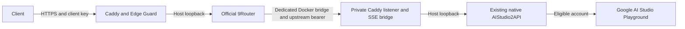

# Free-First AI Gateway

The gateway exposes a single approved Google AI Studio Playground model through an official, digest-pinned 9Router. The existing AIStudio2API installation owns account selection, eligibility, quota and cooldowns.

- [Authoritative execution plan](MASTER_PLAN_V9_AUTONOMOUS_EXECUTION.md)
- [Live verification and delivery status](EXECUTION_TRACKER.md)
- [Deployment and rollback runbook](docs/runbook.md)
- [Legacy retirement assessment](docs/legacy-retirement.md)
