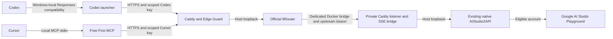

# Free-First AI Gateway

The gateway exposes approved Google AI Studio Playground models through an official, digest-pinned 9Router. Production clients stay on `free/gemini-3.8-flash`. A separate restricted pilot credential can use `free/gemini-3.5-flash-lite`. The existing AIStudio2API installation owns account selection, eligibility, quota and cooldowns.

- [Authoritative execution plan](MASTER_PLAN_V9_AUTONOMOUS_EXECUTION.md)
- [Live verification and delivery status](EXECUTION_TRACKER.md)
- [Deployment and rollback runbook](docs/runbook.md)
- [Windows client dependency and migration matrix](docs/client-migration.md)
- [Legacy retirement assessment](docs/legacy-retirement.md)
- [Model eligibility and failover matrix](docs/model-eligibility-matrix.md)
